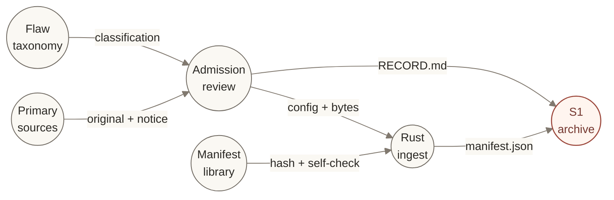
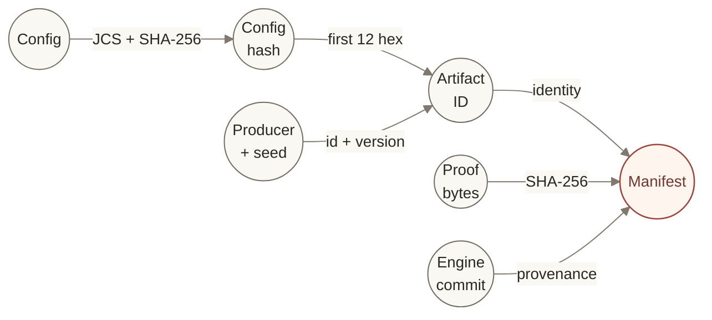
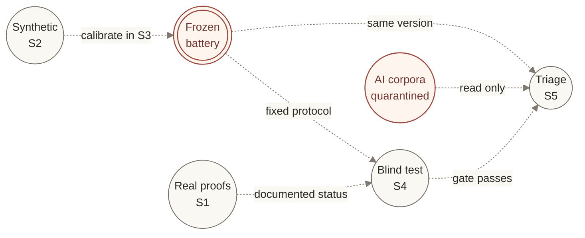

# SYNDEOM

**Calibration infrastructure for mathematical proof triage.**

SYNDEOM (συνδέω, *syndéō*, “to bind together”) is a research program for measuring how reliably
triage methods detect flaws in mathematical proofs, and how much expert attention that detection
costs. Its intended instrument combines labeled synthetic proofs, documented real examples, a
versioned flaw taxonomy, and a calibrated detector battery for informal mathematics and Lean 4.

The principal deliverables are **fooling length**—where a detector becomes statistically equivalent
to chance—and **expert-minutes per true positive**. A precisely measured failure to detect flaws
is a valid result. Outputs about real manuscripts are triage scores with uncertainty; they are
never verdicts.

[Status](#status) · [Architecture](#architecture) · [Artifact contract](#artifact-contract) ·
[Calibration](#calibration-and-validation) · [Quick start](#quick-start) ·
[Repository](#repository-map) · [Governance](#governance-and-contribution)

> **Research stage: S1 — ground-truth corpus.** The manifest library, ingestion CLI, first canonical
> derivation producer, narrow positive-pair producer, and Lean verification fixture are implemented. Synthetic generation,
> the detector battery, calibration reports, and contact scoring remain planned work.
> This repository does not yet provide a
> calibrated proof-triage service.

## Status

**PR 4 was merged by the owner on 2026-10-20 at 18:10:13 UTC.** Main contains the first
Judson/Mathlib positive statement pair. This branch completes the reproducible
[S1.4 coverage and interim-power report](analysis/s1-4/report/report.md) for that merged
corpus. The harvest remains at the Session 20 prefix of 2026-10-14. The authoritative
gate checklist, evidence, and next action are maintained in [`PROGRAM/STATE.md`](PROGRAM/STATE.md).

| Surface | Implemented or recorded | Remaining boundary |
|---|---|---|
| Foundation | Ratified constitution; 14 flaw classes in taxonomy `0.1.0`; S0 closed | Constitutional and taxonomy changes require an ADR |
| Ground truth | 34 representations: 32 logical roots, two canonical children, one admitted positive pair; S1.4 report reproduced | First-parent status hold, carried label questions and cold-start assessment remain; Gate S1 is open |
| Rust engine | `syndeom-manifest` library; `syndeom-ingest`, `syndeom-derive` and `syndeom-pair` CLIs, all `0.1.0` | Ingestion and derivation preserve reviewed evidence; they do not determine mathematical truth |
| Formal verification | Pinned Lean/Mathlib project, golden theorem, and axiom audit | A successful build alone does not establish statement fidelity |
| Calibration | Experimental design and phase gates specified | No synthetic corpus, calibrated battery, freeze tag, or contact report yet |

The [Rust inventory](analysis/s1-4/README.md) distinguishes representations, logical items,
source families and flaw instances. The 32 roots carry **46 flaw instances across five classes**;
nine classes have no real examples and cannot be validated by S4 on this prefix. **Thirty roots
have no canonical length.** Two canonical informal selections supply 75 tokens / one proof step
and seven tokens / zero proof steps; the latter is the positive statement pair, not a
positive-length informal proof control. Its 14-token Lean alias does not measure the transitive
Mathlib proof. No detector performance or numerical power is inferred from these counts.

Historical labels remain visible: statement truth is 5 true / 17 false / 10 undetermined;
offered-proof validity is 1 valid / 31 invalid. The first-parent promotion hold, seven truth
questions and seven severity questions qualify use without rewriting labels. The explicitly
unflagged subset contains 17 roots; documentary grouping yields 22 source-ID arrays, not an
effective sample size. All real-item cells are **expected underpowered** for the equivalence
test pending S3's design-derived N_min and frozen protocol.

The owner merge and [retained pair checks](analysis/s1-2/implementation/VERIFICATION.md)
support the positive-pair admission. No separate GitHub reviewer approval is recorded, no
new mathematical claim is promoted to PROVEN, and this informed session does not close S1.
The [obligation ledger](analysis/s1-4/OBLIGATIONS.md) sets the next action: resolve the
documented status-support hold on `s1_ingest-v0.1.0-63e23a952084`. Harvest remains paused
after candidate 27, `1403.4485`; candidate 28, `1403.6317`, remains next.

## Architecture

SYNDEOM currently operates as a **local, file-based research pipeline**. Rust owns canonical
manifest construction, canonical derivation, validation, and coverage aggregation; Lean checks the formal fixture;
Python assists discovery and orchestrates reproduction.
The repository holds the evidence, decisions, and execution record. There is no deployed API,
queue, or database in the present implementation.

### 01 · Evidence into an archive

The S1.1 path begins with a published original and its erratum or retraction notice.
The separate S1.2 path pairs one independently published statement with its reviewed Mathlib argument.
Admission review establishes provenance, records the licence, and argues the flaw classification
before the producer runs. The CLI validates structure and consistency, computes hashes, and
writes the manifest.



*Implemented relationships. Circles identify actors or artifacts; arrows name their contribution.*

- [`lab/`](lab/) retrieves candidates and comparison material; it has **zero result authority**.
- [`engine/ingest/`](engine/ingest/) implements the deterministic producer `s1_ingest`. It
  rejects inconsistent inputs and refuses conflicting content under an existing artifact ID.
- [`engine/manifest/`](engine/manifest/) implements schema checks, byte-format parsing, hashes,
  commanded-versus-achieved fidelity, and parent/derivative consistency checks.
- [`engine/derive/`](engine/derive/) implements `s1_derive`: reviewed statement/proof slices from
  one gzip TeX source become canonical informal Markdown, with the full original source retained
  as external context. It validates actual bytes, inherited labels, and mapped flaw locations.
- [`engine/pair/`](engine/pair/) implements the fixed ADR-0007 archive/canonical pair contract,
  with executable-input provenance, actual-byte validation, full output preflight and fresh receipts.
- [`analysis/s1-4/`](analysis/s1-4/) publishes the Rust-owned inventory, qualified coverage,
  frozen length bins and interim-power statement. The example target lives outside the
  pair producer's frozen source closure; Python only orchestrates reproducibility checks.
- [`groundtruth/`](groundtruth/) retains the archival item and its written evidence.
  [`lean/`](lean/) supplies the separate formal build and axiom-audit path.

Admission and licensing are review obligations: the CLI checks their input shape, not the
underlying scholarship or redistribution rights. The procedure is
[ADR-0003](PROGRAM/DECISIONS/ADR-0003.md) for errata and
[ADR-0007](PROGRAM/DECISIONS/ADR-0007.md) for the reviewed positive pair.

## Artifact contract

Every counted proof artifact has a manifest. The current producer writes
**`syndeom-manifest/2`**; the library also accepts `/1` under its original rules. Consumers pin the
schema they understand. [ADR-0001](PROGRAM/DECISIONS/ADR-0001.md) defines the contract and amendments.

### 02 · Identity, bytes, and provenance



*Artifact identity is derived from configuration and producer identity. Content integrity is
checked separately against the exact file bytes.*

```text
config_hash = SHA-256(JCS(config))
content_hash = SHA-256(exact file bytes)
artifact_id = <generator.id>-v<version>-<config_hash[0:12]>[-s<seed>]
```

JCS is the JSON Canonicalization Scheme. Synthetic artifacts carry an integer seed; ground-truth
and contact items carry `seed: null` and omit the suffix. The manifest also records origin,
producer version, engine commit, file formats and storage, ground truth where permitted, and
commanded/achieved statistics with fidelity verdicts. Formal files carry their toolchain pins.

| Origin | Location | Ground-truth basis | Use |
|---|---|---|---|
| `synthetic` | [`corpora/`](corpora/) | `by-construction` | Planned S2 generation and S3 calibration |
| `ground-truth` | [`groundtruth/`](groundtruth/) | `documented-by-source` or `formalized-in-mathlib` | S1 evidence; later S4 validation |
| `contact` | [`contact/`](contact/) | **`ground_truth: null`** | S5 only; quarantined until the prescribed gates pass |

**Archival and detector inputs are distinct.** `raw/1` preserves original bytes. The detector
interface is specified for `syndeom-informal-md/1` (`proof.md`) and `syndeom-lean/1` (`Proof.lean`).
A real item to be scored needs a derived canonical artifact naming `config.derived_from` and
`config.method`, preserving its parent's status and flaw labels, and documenting re-expressed
locations. The first derivation producer and one canonical child now exist under
[ADR-0006](PROGRAM/DECISIONS/ADR-0006.md): `s1_derive-v0.1.0-c08f9e3ec092`, derived from
`s1_ingest-v0.1.0-00f28e252823`. The reviewed procedure preserves the original offered proof;
it does not repair its argument. Metadata, the source map, and the
[source-fidelity review](groundtruth/s1_derive-v0.1.0-c08f9e3ec092/RECORD.md) are committed;
restricted proof/context bytes are external. The existing Lean golden audit does not formalize
or certify this informal child. Canonical promotion of a separate parent remains on hold as
documented in [the evidence record](analysis/s1-3/README.md#evidence-and-limits).

**Statement truth and proof validity are independent fields.** Schema `/2` permits an undetermined
statement (`value: null`, `method: "undetermined"`) only with an invalid proof. Ten current items
have this status. They may contribute to proof-flaw calibration, but must be excluded from
truth-dependent cells, including the FLAW-0011 and FLAW-0012 composites. `correct: false` on such
an item does not assert that its theorem is false.

Storage is explicit: `committed` retains permitted bytes; `external` retains a manifest and digest
without redistributing the original; `regenerable` is reserved for synthetic artifacts. Synthetic
proof bytes default to regeneration and hash verification; manifests remain committed.

## Calibration and validation

The following is the **specified research architecture, not an implemented scoring path**.
Three populations remain separate: synthetic artifacts establish calibration, real proofs with
documented status test the frozen battery, and AI-generated contact corpora are examined last.

### 03 · Three populations, one frozen protocol



*Dashed arrows are planned execution paths. The double ring marks the immutable battery version;
red identifies the freeze and contact boundary. Contact observations cannot tune that version.*

| Phase | Required outcome | State |
|---|---|---|
| S0 · Foundation | Verified sources, ratified rules, manifest schema, taxonomy, reproducible scaffold | Closed |
| S1 · Ground truth | Sourced real items, canonical derivatives, informal–formal pairs, coverage and power statement | Open |
| S2 · Generator | Seeded informal/formal variants, flaw injection, padding, measured generation fidelity | Planned |
| S3 · Calibration | Detector battery, ROC/AUC with intervals, fooling lengths, cost model, referee design, `battery-freeze-v1` | Planned |
| S4 · Validation | Blind test on S1 items; class-specific recall, false-positive rates, and power analysis | Planned |
| S5 · Contact | Versioned manuscript triage scores with uncertainty; reproducible report and engineer sign-off | Planned |

The first generator family is specified as seeded Rust templates and grammars. Any LLM-assisted
family requires a separate ADR covering reproducibility and leakage. The planned battery
prioritizes dependency extraction, hypothesis checks, lemma usage, citation existence,
autoformalization, statement fidelity, and axiom audits. Surface statistics remain controls whose
expected weakness must be tested.

Calibration crosses **detector × flaw class × proof length × severity**, with matched correct
proofs, padded correct proofs, and other flaw classes as controls. Leave-one-generator-out and
leave-one-flaw-class-out evaluations test whether detectors recognize flaws or merely generators.
Conclusions require joint detector evidence within measured false-positive and ROC contexts.
The [14-class taxonomy](PROGRAM/FLAWS.md) includes both local errors and failures that compilation
alone cannot establish, such as statement drift and uninformative padding.

**“Fooled” has a pre-declared statistical meaning.** A cell qualifies only when its 95% bootstrap
AUC interval lies entirely within **[0.45, 0.55]** and its sample size meets `N_min`. Fooling length
is the smallest tested length meeting that rule, per detector and flaw class. An interval merely
containing 0.5 is “not distinguished from chance”; an insufficient cell is “underpowered.”
`N_min` must be derived for balanced flawed/correct cells at 90% power when true AUC is 0.5,
then simulation-checked before curves are computed. Dependence among variants of one seed theorem
must be accounted for.
See [ADR-0004](PROGRAM/DECISIONS/ADR-0004.md).

Expert cost initially uses a pre-declared review-time model. The blinded human-referee protocol
is to be designed and versioned; recruitment, contact, and execution require the engineer of
record's decision. A post-contact battery change creates a new version and freeze; prior results
retain their original version.

## Quick start

Use Git, Bash, Python 3, Rust through `rustup`, and Lean through `elan`. On Windows, run the shell
examples in **Git Bash** with Python, Cargo, and Lake on `PATH`. Keep the checkout and scratch files
on a local disk outside OneDrive.

| Dependency | Repository pin |
|---|---|
| Rust | `1.91.0`, with `clippy` and `rustfmt` — [`rust-toolchain.toml`](rust-toolchain.toml) |
| Lean | `leanprover/lean4:v4.34.1` — [`lean/lean-toolchain`](lean/lean-toolchain) |
| Mathlib | `d13f23b723b8a846827a245b89c10fc7d3f11612` — [`lean/lakefile.toml`](lean/lakefile.toml) |
| Dependency locks | [`engine/Cargo.lock`](engine/Cargo.lock) and [`lean/lake-manifest.json`](lean/lake-manifest.json) |

From a local parent directory:

```bash
git clone https://github.com/Quigles1337/Syndeom.git
cd Syndeom

# Populate the compiled Mathlib cache, then run the complete repository gate.
(cd lean && lake exe cache get)
bash scripts/check.sh
```

The first run downloads dependencies and compiled Lean modules; allow time and disk space for
Mathlib. The gate checks the Lean build and golden fixture's axiom set, Rust formatting and Clippy,
all Rust tests, LF/BOM/trailing-newline hygiene, and register cross-references. A successful run
ends with **`GATE: GREEN`**. [CI](.github/workflows/check.yml) runs the same gate as an advisory
check; the recorded local run is authoritative.

### Exercise ingestion without writing a corpus item

From the repository root, this dry run uses the checked-in **test fixture**, whose source IDs are
placeholders. It prints a manifest and leaves `groundtruth/` untouched.

```bash
cargo run --locked --manifest-path engine/Cargo.toml -p syndeom-ingest -- \
  --config engine/ingest/tests/fixtures/item-a.json \
  --bytes engine/ingest/tests/fixtures/original.bin \
  --root . \
  --engine-commit "$(git rev-parse HEAD)" \
  --dry-run
```

Real ingestion follows [ADR-0003](PROGRAM/DECISIONS/ADR-0003.md): register the original and notice,
resolve storage rights, prepare the item config, run the producer, then add the written record and
harvest-log entry. Test fixtures are never admitted as real evidence.

| CLI exit | Meaning |
|---|---|
| `0` | Manifest printed, written, or already identical |
| `1` | Usage or I/O error |
| `2` | Input shape or manifest consistency failure |
| `3` | Different manifest or bytes already exist under that artifact ID |

For a Rust-only development check, run `cargo test --locked --manifest-path engine/Cargo.toml
--all-targets --all-features`. This is a partial check; it does not replace the repository gate.

### Reproduce the first canonical derivation

Follow the [S1.3 reproduction instructions](analysis/s1-3/README.md#reproduce-the-real-example).
The Python helper verifies the original source hash and invokes the Rust producer twice,
comparing exact proof, context, manifest, and source-map bytes. Choose a new external work
directory for each run; existing destinations are refused. The retained evidence pins producer
commit `49e47237924eddf0c39c24aefad0eb9aa02ee8b3`, which predates generation of the real child.

### Reproduce the proposed first positive pair

Follow [the S1.2 implementation instructions](analysis/s1-2/implementation/README.md#reproduce-into-a-new-destination).
The helper retrieves frozen sources, invokes the committed Rust producer, compiles/audits the
actual emitted alias, compares a fresh replay and runs labeled refusal controls. Every run
uses a new external destination. This branch proposes one pair for review; it does not claim
accepted-main admission or PROVEN promotion.

## Repository map

| Path | Responsibility |
|---|---|
| [`PROGRAM/`](PROGRAM/) | Constitution, current state, claims, sources, taxonomy, ADRs, and session history |
| [`engine/manifest/`](engine/manifest/) | Canonical Rust schema, identity, byte formats, fidelity, and consistency library |
| [`engine/ingest/`](engine/ingest/) | Deterministic S1 ingestion CLI and golden tests |
| [`engine/derive/`](engine/derive/) | Deterministic reviewed TeX derivation CLI and mechanical tests |
| [`engine/pair/`](engine/pair/) | Narrow reviewed positive-pair archive/canonical CLI, provenance and refusal tests |
| [`lean/`](lean/) | Pinned formal project, golden theorem, and axiom audit |
| [`lab/`](lab/) | Exploratory Python candidate discovery and examination |
| [`groundtruth/`](groundtruth/) | Real archival manifests, canonical child metadata and recipes, item records, permitted originals, and harvest log |
| [`corpora/`](corpora/) | Reserved for manifested synthetic artifacts in S2 |
| [`contact/`](contact/) | Reserved for quarantined AI-generated corpora in S5 |
| [`analysis/`](analysis/) | Engineering evidence and future experimental designs and calibration/validation/contact reports |
| [`analysis/s1-3/`](analysis/s1-3/) | First canonical derivation receipts, preservation checks, and reproduction instructions |
| [`analysis/s1-2/`](analysis/s1-2/) | Historical procedure evidence, separate source-map correction, implementation and proposed-admission evidence |
| [`sources/`](sources/) | Source copies whose licences permit redistribution |
| [`scripts/`](scripts/) | Local verification gate and register checks |
| [`scripts/reproduce_s1_3.py`](scripts/reproduce_s1_3.py) | Source retrieval and orchestration of two independent Rust derivations |

## Governance and contribution

The [constitution](PROGRAM/SYNDEOM-PROGRAM.md) and recorded
[architectural decisions](PROGRAM/DECISIONS/) govern the program. This README is an orientation
layer. Begin work with [`STATE.md`](PROGRAM/STATE.md), the latest
[`HANDOFF.md`](PROGRAM/HANDOFF.md) entry, and the relevant decisions; verify their claims against
the code and gate.

| Evidence rule | Practical consequence |
|---|---|
| Truth and triage, not understanding | No scores for insight, pedagogy, or explanatory quality |
| No manuscript verdicts | Report detector scores, uncertainty, battery version, and named flaw classes |
| “Proven” is reserved | Require sorry/admit-free Lean, an axiom audit allowing at most `propext`, `Classical.choice`, and `Quot.sound`, and recorded line-by-line statement-fidelity review |
| Reproducibility is required | Results record engine SHA, seeds, configuration, taxonomy/battery versions, and uncertainty |
| Contact is quarantined | Freeze before validation and contact; never tune an existing battery from contact observations |
| Evidence has an audit trail | Sources and claims live in registers; decisions and session handoffs preserve the reasoning |

Use feature branches for work in progress, preserve UTF-8/LF text, run
[`scripts/check.sh`](scripts/check.sh), and record evidence in the session handoff. Commit messages
follow `[S<phase>][<CLAIM-ID or ADR-ID or FLAW-ID or INFRA>] imperative summary`. Public release,
constitutional amendments, and human-referee participation follow the engineer-of-record
decisions specified in the constitution.

**Reading paths:** [constitution](PROGRAM/SYNDEOM-PROGRAM.md) for scope;
[state](PROGRAM/STATE.md) for readiness; [claims](PROGRAM/CLAIMS.md) for assertions and evidence;
[sources](PROGRAM/SOURCES.md) for provenance; [taxonomy](PROGRAM/FLAWS.md) for flaw semantics;
[decisions](PROGRAM/DECISIONS/) for contracts; [handoff](PROGRAM/HANDOFF.md) for continuity.

SYNDEOM combines the calibration discipline of
[FRIEDMAN](https://github.com/Quigles1337/FR13DMAN) with the formal-methods discipline of
[KOBER](https://github.com/Quigles1337/KOBER). The sibling interface is a versioned manifest
extension; neither sibling's code is imported. The
[structural map](PROGRAM/SIBLING-MAP-2026-10.md) records the relationship.

## Licence

SYNDEOM's original software and technical documentation are released under the **Apache License
2.0** (SPDX `Apache-2.0`; full text in [`LICENSE`](LICENSE)).

This release excludes third-party materials under `sources/`, `groundtruth/`, and `contact/`,
which retain the terms recorded in [`PROGRAM/SOURCES.md`](PROGRAM/SOURCES.md). It also excludes
separately controlled DARQ Labs research materials: these are marked where they appear, remain
proprietary, and are outside the Apache release.

The engineer of record established this boundary on 2026-10-13 in
[ADR-0000, Addendum 2](PROGRAM/DECISIONS/ADR-0000.md). Licence-text provenance is recorded as
S-0019 in the source register.
