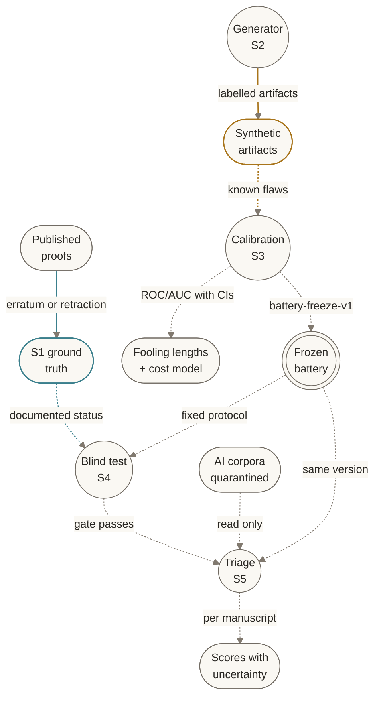
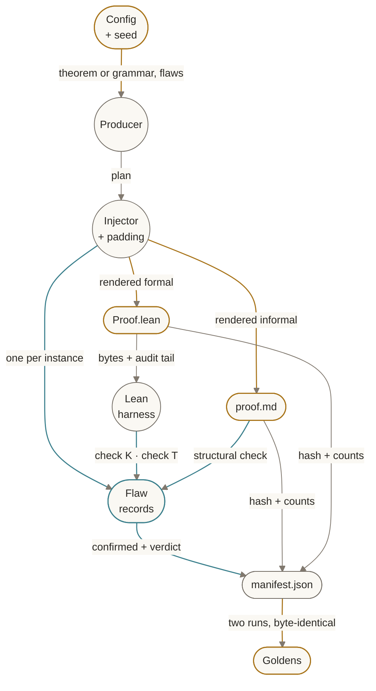
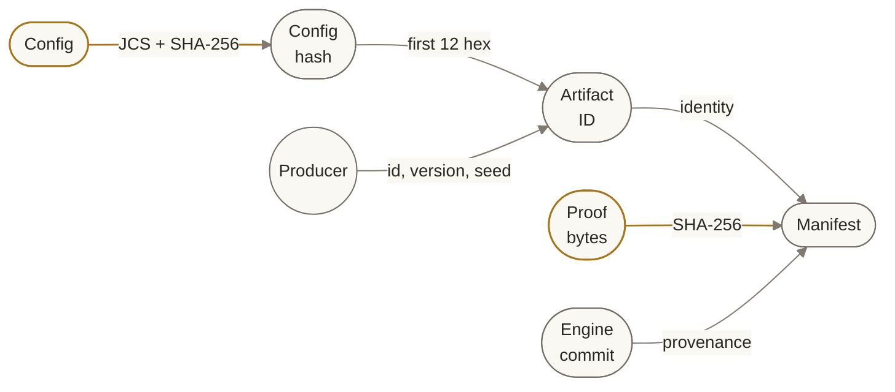
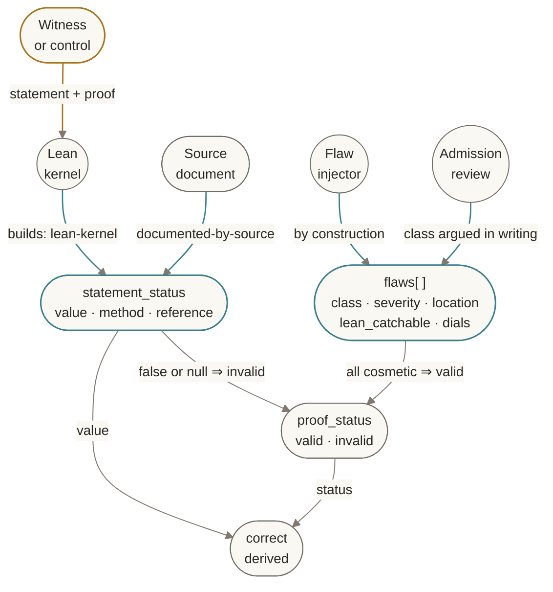
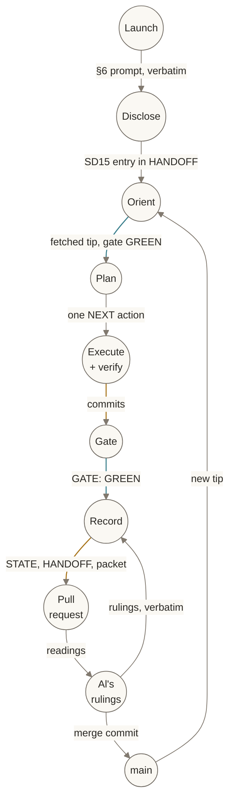

# SYNDEOM

[](https://doi.org/10.5281/zenodo.23682780)

**Calibration infrastructure for mathematical proof triage.**

AI systems now write mathematical proofs faster than people can check them, and the proofs arrive
without calibration data: nobody can say how often a given way of checking misses an error, or how
that rate changes as proofs grow longer. SYNDEOM (συνδέω, *syndéō*, “to bind together”) is a
research program that sets out to measure it.

It builds proofs, informal and in Lean 4, whose flaws are known because it put them there, and it
collects real proofs whose status is documented: published proofs with recorded errata or
retractions, and theorems with a Mathlib formalization. The synthetic proofs will calibrate a
battery of detectors, flaw class by flaw class; the real ones will then test that battery blind.
For each detector and class the program will report a **fooling length**, the proof length at which
the detector becomes statistically equivalent to chance, and a **cost in expert-minutes per true
positive**, because the verification bill is the point. A precisely measured failure to detect is a
result of equal rank.

SYNDEOM measures truth and triage, never understanding. About a real manuscript it will only ever
report calibrated triage scores with uncertainty, never a verdict, and “proven” is reserved for
sorry-free Lean proofs that pass an axiom audit and a statement-fidelity review.

> **Where it stands:** Gates S0 and S1 are closed, and S2, the synthetic generator, is being built.
> No detector battery exists yet; this repository does not provide a calibrated proof-triage
> service.

[Status](#status) · [Architecture](#architecture) · [Governance](#governance) ·
[Quick start](#quick-start) · [Repository](#repository-map) · [Citation](#citation) ·
[Licence](#licence)

## Status

*As of merge commit
[`e7b8357`](https://github.com/Quigles1337/Syndeom/commit/e7b835762dfdc19154668cae529463345561541e)
(pull request [#40](https://github.com/Quigles1337/Syndeom/pull/40), 2026-11-02).*
[`PROGRAM/STATE.md`](PROGRAM/STATE.md) holds the program's claims and its one next action; git
history and the gate hold the evidence. Where this page and those records differ, the records
govern.

| Phase | Gate | Recorded in |
|---|---|---|
| S0 · Foundation: sources, constitution, manifest schema, taxonomy, scaffold | **Closed** 2026-10-13; cold-start test passed | [STATE](PROGRAM/STATE.md), *Gate S0 exit criteria* |
| S1 · Ground truth: real proofs with documented status | **Closed** 2026-10-26; cold-start test passed | [STATE](PROGRAM/STATE.md), *Gate S1 exit criteria*; [HANDOFF](PROGRAM/HANDOFF.md), Session 29 |
| S2 · Generator: synthetic proofs with labelled flaws | **Open** since 2026-10-26: S2.1–S2.4 under way; the fidelity sweep, the goldens-lint-audit criterion and the cold-start test are open | [STATE](PROGRAM/STATE.md), *Gate S2 exit criteria* |
| S3 · Detector battery, calibration, freeze | Not started: no detector, no curves, no `battery-freeze-v1` tag | [Constitution](PROGRAM/SYNDEOM-PROGRAM.md), §2; the repository's tags |
| S4 · Blind validation on the S1 corpus | Not started | [Constitution](PROGRAM/SYNDEOM-PROGRAM.md), §2 |
| S5 · Contact with AI-generated corpora | Not started; the contact quarantine holds | [Constitution](PROGRAM/SYNDEOM-PROGRAM.md), §2 and SD8 |

**S2 to date.**

- **Design and code.** [ADR-0011](PROGRAM/DECISIONS/ADR-0011.md) fixes one deterministic family of
  seeded Rust templates and grammars, no LLM, behind one shared interface, the *plan*; the engineer
  of record, Al, accepted it by rulings on pull request #20 (2026-10-27).
  [`engine/generate/`](engine/generate/README.md) implements it with two producers: `s2_template`
  (versions 0.1.0–0.7.0), on twelve hand-authored seed theorems from the taxonomy's examples and
  ADR-0001's fixture, and `s2_grammar` (0.1.0–0.8.0), which generates chains of commanded length.
- **Flaw classes.** `s2_template` can inject all fourteen classes of taxonomy `0.1.0`, though some
  sub-variants still lack material. Two of ADR-0011's four grammars exist. `ring_chain`, polynomial
  identities over ℤ, realizes every class the ADR assigns a grammar for which it has material:
  FLAW-0001, FLAW-0003 `cycle`, FLAW-0004 `routine-true`, FLAW-0007 `unused`, FLAW-0009 `axiom`,
  FLAW-0010 (a), FLAW-0011 and FLAW-0013. `ineq_chain`, inequalities over ℝ, carries its control
  and FLAW-0001 (STATE, *Gate S2 exit criteria*).
- **Goldens.** 120 cases at seed 7, regenerated byte for byte by the gate: 69 from the template's
  seeds, 41 on `ring_chain` and 10 on `ineq_chain`
  ([goldens README](engine/generate/tests/goldens/README.md)). Since `s2_template` 0.2.0, each
  version's goldens come from two production runs compared byte for byte, and each version's
  evidence is its packet, [`analysis/s2-generate-1/`](analysis/s2-generate-1/) to
  [`analysis/s2-generate-15/`](analysis/s2-generate-15/README.md).
- **Not yet.** No artifact under `corpora/`, no fidelity sweep, no detector and no battery (STATE,
  *Gate S2 exit criteria*). No claim in [`PROGRAM/CLAIMS.md`](PROGRAM/CLAIMS.md) is MEASURED,
  REPRODUCED or PROVEN.
- **Next.** STATE's NEXT-SINGLE-ACTION at this merge: `s2_grammar` 0.9.0, FLAW-0005 `unshown` on
  `ineq_chain`, Lean probes first.

**S1 since its gate.** Gate S1 closed on 35 archived representations and 32 effective logical
items, among them one admitted informal–formal pair (STATE, *Gate S1 exit criteria*). The first
later prefix, harvest candidates 28–30, was then reviewed, integrated and counted as its own event:
**40 archived representations, 37 effective logical items**. Nine of the fourteen flaw classes have
no real example, so S4 cannot validate them, and every real-item cell is expected to be underpowered
until S3 derives N_min ([report](analysis/s1-later-prefix-1/report/report.md);
[ADR-0013](PROGRAM/DECISIONS/ADR-0013.md)). The harvest is paused after candidate 30 (STATE,
*NEXT-SINGLE-ACTION*). The design as it stood at Gate S1's closure is registered on Zenodo
([Citation](#citation)).

## Architecture

SYNDEOM is a local, file-based pipeline with no deployed service. Rust ([`engine/`](engine/)) owns
every canonical artifact, check and count; Lean 4 with Mathlib ([`lean/`](lean/)) checks formal
statements and proofs; Python assists discovery with no result authority (SD10). In the diagrams,
circles act, stadiums are what they hold or emit, and each arrow is labelled with what crosses it.
The two accent colours only repeat what a label says: **ochre** for artifact flow (configs, files,
goldens) and **teal** for truth flow (ground-truth records, kernel verdicts).

### 01 · The arc: ground truth, generation, calibration, validation, contact

Three populations stay apart. Synthetic artifacts calibrate the battery, which is then frozen; real
proofs with documented status test the frozen version blind; AI-generated corpora are scored last,
read only, by that same version. No seed, grammar or template may be derived from the S1 corpus
(ADR-0011, D6), and contact results never tune a battery in place: a change is a new version with a
new freeze (SD8).



*Ochre: artifact flow · teal: truth flow · grey: the rest · solid: built · dashed: planned · double
ring: the immutable battery version.*

“Fooled” is defined before any curve exists ([ADR-0004](PROGRAM/DECISIONS/ADR-0004.md)). A detector
is fooled in a cell only when the 95% bootstrap interval of its AUC lies entirely inside
[0.45, 0.55] and the cell holds at least N_min items, a size derived from the design for 90% power
before any curve is computed; the fooling length is the smallest proof length at which that holds.
An interval that merely contains 0.5 is “not distinguished from chance”, and a smaller cell is
“underpowered”, never fooled.

### 02 · S2: producing one artifact

Every S2 module reads or rewrites one data structure, the plan, and only the renderers emit bytes,
so an injected flaw lands at a known span in `proof.md` and a known line in `Proof.lean`
([ADR-0011](PROGRAM/DECISIONS/ADR-0011.md), D2). A flawed artifact counts only when its flaw is
confirmed: check K requires Lean's first error to fall inside the injected fragment, check T reads
the axiom and usage audit, and informal records get a recorded structural check (D5, D8). A failed
confirmation is kept as a FAIL finding, never regenerated under another seed.



*Ochre: artifact flow · teal: truth flow · grey: the rest. Shown for a pair; an informal-only
artifact has no Lean file. Every draw comes from a labelled stream of `syndeom-rng/1`, so one config
and seed always give the same bytes.*

### 03 · Identity and integrity

Identity is a function of what produced an artifact, and integrity is checked against its exact
bytes ([ADR-0001](PROGRAM/DECISIONS/ADR-0001.md)). The engine commit is verified against the
producer's inputs before anything is written, and synthetic proof bytes under `corpora/` are
regenerated and checked by hash rather than committed ([ADR-0011](PROGRAM/DECISIONS/ADR-0011.md),
D9).



*Ochre: artifact flow · grey: the rest.*

```text
config_hash = SHA-256(JCS(config))
content_hash = SHA-256(exact file bytes)
artifact_id = <generator.id>-v<version>-<config_hash[0:12]>[-s<seed>]
```

JCS is the JSON Canonicalization Scheme. Synthetic artifacts carry an integer seed; ground-truth and
contact items carry `seed: null` and omit the suffix. The producers write `syndeom-manifest/2`, and
consumers pin the schema they understand.

| Origin | Location | Ground-truth basis | Use |
|---|---|---|---|
| `synthetic` | [`corpora/`](corpora/) | `by-construction` | S2 generation; S3 calibration |
| `ground-truth` | [`groundtruth/`](groundtruth/) | `documented-by-source` or `formalized-in-mathlib` | S1 evidence; S4 validation |
| `contact` | [`contact/`](contact/) | none: **`ground_truth: null`** | S5 only, quarantined until the prescribed gates pass |

### 04 · What one artifact's ground truth holds

Whether the statement is true and whether the offered proof proves it are separate fields, which
FLAW-0011 and FLAW-0012 exist to test, and every label names how it was established. For a real
item, admission review establishes provenance and licence and argues the flaw class in writing
before `s1_ingest` writes the manifest ([ADR-0003](PROGRAM/DECISIONS/ADR-0003.md);
[ADR-0007](PROGRAM/DECISIONS/ADR-0007.md) for the pair), and a statement its source leaves open is
recorded as undetermined, only with an invalid proof ([ADR-0001](PROGRAM/DECISIONS/ADR-0001.md)),
and kept out of every truth-dependent cell (STATE, *Standing rulings*).



*Teal: truth entering the record · grey: rules the manifest library derives · ochre: artifact flow.
A record locates its flaw by step and character span in the informal file and by declaration and
line in the formal one.*

## Governance

SYNDEOM runs under a written constitution that assumes its executor forgets everything between
sessions. The executor, Claude Code, does not persist: the repository is the only memory, and every
session must leave it resumable by a cold successor (constitution §0). That one constraint is why
every figure on this page can show its work.



*Ochre: artifact flow (commits, records) · teal: truth flow (gate verdicts) · grey: the rest.*

- **The constitution.** [`PROGRAM/SYNDEOM-PROGRAM.md`](PROGRAM/SYNDEOM-PROGRAM.md): the charter,
  rules SD1–SD17, phases and gates, the session loop and its failure modes. It changes only by ADR;
  ADR-0004, ADR-0005 and ADR-0009 have amended it.
- **The loop (§4).** A session orients from the fetched default branch
  ([ADR-0008](PROGRAM/DECISIONS/ADR-0008.md)), reads STATE, the last HANDOFF entry, the registers
  and the relevant ADRs, and runs the gate: *state files are claims; builds are evidence*. It plans
  one thing, normally the inherited NEXT-SINGLE-ACTION, executes and verifies it (two failures on
  one approach end the attempt), records, and stops green. A session launched with the §6 prompt
  discloses its executor memory first (SD15).
- **The gate (SD9).** [`scripts/check.sh`](scripts/check.sh): the Lean build, an axiom audit of
  the golden fixture and every seed witness, `cargo fmt`, `clippy -D warnings`, every Rust test
  with the goldens, byte hygiene, the register cross-references and the freeze register. The
  default branch always passes it.
- **The records.** STATE holds the current claims, the gate tables with their evidence, the
  standing rulings, the freeze register and one next action. HANDOFF is an append-only log of what
  each session moved, believed, misunderstood and checked for leakage, determinism, manifests and
  drift. Each [ADR](PROGRAM/DECISIONS/) records one decision, the owner's rulings verbatim under
  *Amendments*. The registers keep claims append-only ([CLAIMS](PROGRAM/CLAIMS.md)), sources read
  from primaries with their SHA-256 ([SOURCES](PROGRAM/SOURCES.md)) and the versioned taxonomy
  ([FLAWS](PROGRAM/FLAWS.md)); packets under [`analysis/`](analysis/) hold each step's evidence.
- **Rulings and merges.** Every pull request stops for the engineer of record, Al, whose rulings
  accept, narrow or replace a packet's numbered readings. The rulings are recorded verbatim on the
  branch, and Al merges with a merge commit, never a squash, so every golden's `engine_commit`
  stays a real commit on `main`. Publication, human referees (SD13), constitution amendments and
  the contact quarantine are escalations, never the executor's call (§4.6).
- **The cold-start test.** A gate closes only when a session that is cold under SD15 re-derives the
  program's state from the repository alone, in one pass. Gates S0 and S1 passed it.

None of this makes a result right. It makes every result checkable: the commit that produced it,
the seed and configuration that regenerate it, the session that recorded it and the ruling that
accepted it are all in this repository.

Contributions follow the same loop: feature branches, UTF-8 text with LF line endings, and commits
named `[S<phase>][<CLAIM-ID or ADR-ID or FLAW-ID or INFRA>] imperative summary`. SYNDEOM binds the
calibration discipline of [FRIEDMAN](https://github.com/Quigles1337/FR13DMAN) to the formal-methods
discipline of [KOBER](https://github.com/Quigles1337/KOBER) through a versioned manifest extension,
never a code dependency ([structural map](PROGRAM/SIBLING-MAP-2026-10.md)).

## Quick start

Use Git, Bash, Python 3, Rust through `rustup` and Lean through `elan`. On Windows, run the shell
examples in **Git Bash** with Python, Cargo and Lake on `PATH`, and keep the checkout and scratch
files on a local disk outside OneDrive.

| Dependency | Repository pin |
|---|---|
| Rust | `1.91.0`, with `clippy` and `rustfmt` — [`rust-toolchain.toml`](rust-toolchain.toml) |
| Lean | `leanprover/lean4:v4.34.1` — [`lean/lean-toolchain`](lean/lean-toolchain) |
| Mathlib | `d13f23b723b8a846827a245b89c10fc7d3f11612` — [`lean/lakefile.toml`](lean/lakefile.toml) |
| Dependency locks | [`engine/Cargo.lock`](engine/Cargo.lock) and [`lean/lake-manifest.json`](lean/lake-manifest.json) |

From a local parent directory:

```bash
git clone https://github.com/Quigles1337/Syndeom.git
cd Syndeom

# Populate the compiled Mathlib cache, then run the complete repository gate.
(cd lean && lake exe cache get)
bash scripts/check.sh
```

The first run downloads dependencies and compiled Mathlib modules. A successful run ends with
**`GATE: GREEN`**; its `cargo test` stage regenerates every S2 golden from its recorded config, seed
and Lean observation and compares the bytes. [CI](.github/workflows/check.yml) runs the same gate as
an advisory check; the recorded local run is authoritative. `cargo test --locked --manifest-path
engine/Cargo.toml --all-targets --all-features` runs the Rust tests alone, not the gate.

To exercise ingestion without writing a corpus item, run this from the repository root. It uses the
checked-in **test fixture**, whose source IDs are placeholders, prints a manifest and leaves
`groundtruth/` untouched.

```bash
cargo run --locked --manifest-path engine/Cargo.toml -p syndeom-ingest -- \
  --config engine/ingest/tests/fixtures/item-a.json \
  --bytes engine/ingest/tests/fixtures/original.bin \
  --root . \
  --engine-commit "$(git rev-parse HEAD)" \
  --dry-run
```

Exit `0` means printed, written or already identical; `1` a usage or I/O error; `2` an input-shape
or consistency failure; `3` a different manifest or different bytes already under that artifact ID. Real ingestion follows
[ADR-0003](PROGRAM/DECISIONS/ADR-0003.md), and test fixtures are never admitted as evidence.

Recorded results reproduce into a new directory outside the repository:
[the first canonical derivation](analysis/s1-3/README.md#reproduce-the-real-example) (S1.3),
[the admitted positive pair](analysis/s1-2/implementation/README.md#reproduce-into-a-new-destination)
(S1.2), [the effective inventory at Gate S1](analysis/s1-post-merge-readiness/README.md#reproduce-without-touching-retained-evidence)
and [the first later prefix](analysis/s1-later-prefix-1/README.md#reproduce). The generator's
`generate`, `regenerate` and `verify` commands are in
[`engine/generate/README.md`](engine/generate/README.md#cli), and each golden's `case.json` holds its
config and seed.

## Repository map

| Path | Responsibility |
|---|---|
| [`PROGRAM/`](PROGRAM/) | Constitution, STATE, HANDOFF, the CLAIMS, SOURCES and FLAWS registers, ADRs and the sibling map |
| [`engine/manifest/`](engine/manifest/) | Canonical schema, identity, byte formats, fidelity and consistency library; the S1.4 coverage tool |
| [`engine/ingest/`](engine/ingest/) | S1 ingestion CLI, with the effective-inventory and later-prefix tools |
| [`engine/derive/`](engine/derive/), [`engine/pair/`](engine/pair/) | Canonical S1 derivations: reviewed TeX slices (S1.3) and the informal–formal positive pair (S1.2) |
| [`engine/generate/`](engine/generate/) | The S2 family: plan, renderers, injector, padding, RNG, Lean harness, `s2_template`, `s2_grammar`, seeds and goldens |
| [`lean/`](lean/) | Pinned Lean and Mathlib project: the Golden B fixture, the seed witnesses and the axiom audit |
| [`lab/`](lab/) | Exploratory Python for candidate discovery; zero result authority |
| [`groundtruth/`](groundtruth/) | Real S1 items: manifests, records, permitted originals, derivation recipes and the harvest log |
| [`corpora/`](corpora/) | Manifested synthetic artifacts; none written yet (the fidelity sweep writes here) |
| [`contact/`](contact/) | Reserved for quarantined AI-generated corpora in S5, under SD8 |
| [`analysis/`](analysis/) | Evidence packets: `s1-*` for the ground-truth corpus, `s2-generate-*` for the generator |
| [`sources/`](sources/) | Stored copies of sources whose licences permit redistribution |
| [`scripts/`](scripts/) | The gate (`check.sh` with its register and freeze checks), the ADR-0008 orientation preflight (outside the gate) and the S1.3 reproduction helper |

## Citation

Cite the registered design, the snapshot at Gate S1's closure, by its version DOI,
[10.5281/zenodo.23682781](https://doi.org/10.5281/zenodo.23682781). The concept DOI,
[10.5281/zenodo.23682780](https://doi.org/10.5281/zenodo.23682780), covers all versions and
resolves to the latest. Zenodo's citation and BibTeX for the registration:

> Zalewski, A. D. (2026). SYNDEOM: Calibration Infrastructure for Mathematical Proof Triage — Design Registration at Gate S1 (Version gate-s1-registration) [Computer software]. Zenodo. https://doi.org/10.5281/zenodo.23682781

```bibtex
@software{zalewski_2026_23682781,
  author       = {Zalewski, Alexander David},
  title        = {SYNDEOM: Calibration Infrastructure for
                   Mathematical Proof Triage — Design Registration at
                   Gate S1
                  },
  month        = oct,
  year         = 2026,
  publisher    = {Zenodo},
  version      = {gate-s1-registration},
  doi          = {10.5281/zenodo.23682781},
  url          = {https://doi.org/10.5281/zenodo.23682781},
}
```

The deposited file is `Syndeom-gate-s1-registration.zip`: 13,370,992 bytes, checksum
`md5:f78dab5eafc6e95f595b1f38b537c9f9` as Zenodo reports it, SHA-256
`95f7d1b7d37aeb604b633b902d8f5e13ab46f5cfd5b582d8d64a299f52039cfc`. It is `git archive` of the
annotated tag [`gate-s1-registration`](https://github.com/Quigles1337/Syndeom/tree/gate-s1-registration)
(commit `2018d5e79ea23fa200e560d628bec5e91edf0956`) without the two files that
[`THIRD-PARTY-NOTICES.md`](THIRD-PARTY-NOTICES.md) lists as not included in the deposit. It is a
registration archive: the full gate runs on a full clone at the tag.

## Licence

SYNDEOM's original software and technical documentation are licensed under the **PolyForm
Noncommercial License 1.0.0** (SPDX `PolyForm-Noncommercial-1.0.0`; full text in
[`LICENSE`](LICENSE)). Copyright 2026 Alexander David Zalewski.

In plain terms (the licence text governs, not this summary):

- **Noncommercial use is free.** You may use, change and share SYNDEOM for any noncommercial
  purpose. That includes personal research, experiment, testing, study and hobby projects with
  no anticipated commercial application. It also includes use by a charitable organization,
  educational institution, public research organization, public safety or health organization,
  environmental protection organization or government institution, whatever its funding.
- **When you share it,** pass on the licence terms (or their URL) and the `Required Notice:` line
  at the top of [`LICENSE`](LICENSE).
- **Commercial use needs a separate licence.** For commercial licensing, contact Alexander David
  Zalewski at **adz@alphx.io**.
- **Earlier versions stay under Apache-2.0.** Every version published before 2026-10-26, through
  commit `c9372b1`, was released under the Apache License 2.0. Copies obtained under it remain
  under it.

The licence does not cover:

- third-party materials under `sources/`, `groundtruth/` and `contact/`, the Mathlib and Lean
  toolchain sources, and the Rust dependencies, which keep the terms recorded in
  [`PROGRAM/SOURCES.md`](PROGRAM/SOURCES.md) and in each item's manifest;
- separately controlled DARQ Labs research materials, which are marked where they appear and
  remain proprietary;
- any artifact whose own manifest records a different licence for a SYNDEOM-authored component.
  For example, the S1.2 alias wrapper is recorded as Apache-2.0.

[`THIRD-PARTY-NOTICES.md`](THIRD-PARTY-NOTICES.md) lists every file that the licence does not
cover, with its licence and attribution. The Apache-2.0 text for the files under that licence is
[`LICENSES/Apache-2.0.txt`](LICENSES/Apache-2.0.txt).

The engineer of record made this change on 2026-10-26 in
[ADR-0010](PROGRAM/DECISIONS/ADR-0010.md). It supersedes the Apache-2.0 choice of
[ADR-0000, Addendum 2](PROGRAM/DECISIONS/ADR-0000.md) and keeps its boundary. The provenance of
the licence text is recorded as S-0073 in the source register (S-0019 for the earlier Apache
text).
